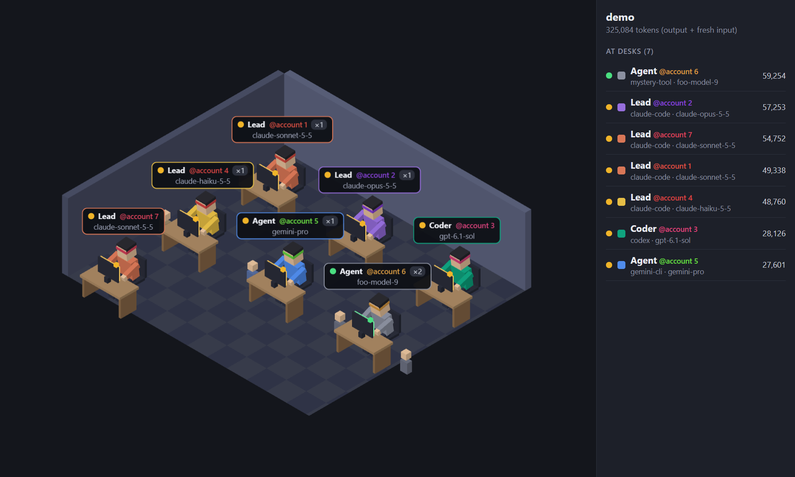
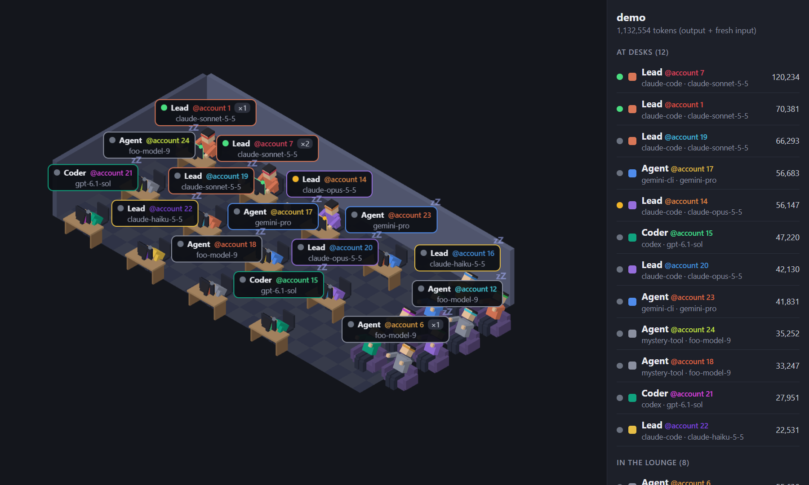
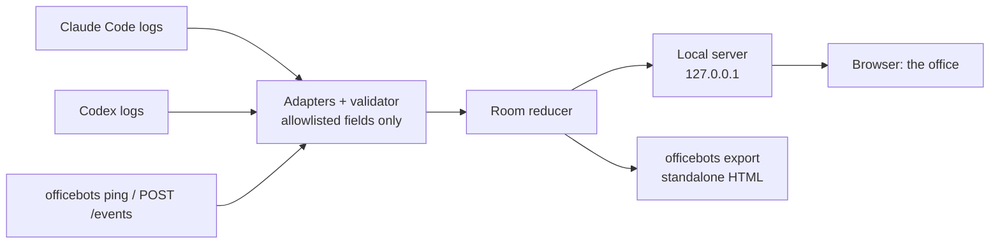

<div align="center">

# officebots

**A live isometric office that shows which AI agents are working on your project.**

Every agent gets a character at a desk, with its model, role, account and token count.<br>
Claude Code and Codex are read from their local logs. Nothing leaves your machine.

[](https://github.com/inferism/officebots-ai/actions/workflows/ci.yml)
[](LICENSE)




<sub>A synthetic demo office (<code>officebots demo</code>), not real project data.</sub>

</div>

## What it does

- **One character per agent.** A character is a tool, a model, an account and a role, for example "Claude Code, Opus 5.5, work account, Lead". Switching model moves the work to the other character, which is correct for "who worked on this".
- **Live status.** Green while working, amber while waiting for you, asleep (head down, a floating "zZ") after 90 seconds of silence. The next event wakes it at the same desk.
- **Token counts.** The number is output plus fresh input (cache reads are excluded); hover a character for the full breakdown.
- **Subagents show up as interns**, small figures around their parent's desk with a `×N` badge.
- **It scales.** Past 12 desks the longest-sleeping characters move to sofas in a lounge, and the room grows and zooms out to fit.
- **One office per project.** Sessions in subfolders and git worktrees count as the same project. Each office runs on its own local port.
- **Standalone snapshots.** `officebots export` writes a single `.html` file you can open anywhere, with no server running.

<div align="center">

<br><sub>24 synthetic agents: sleepers have moved to the lounge.</sub>
</div>

## Install

You need **Node 22.15 or newer**. officebots is not on npm yet, so install it from source:

```bash
git clone https://github.com/inferism/officebots-ai.git
cd officebots-ai
npm ci
npm run build
npm install -g .
```

Then, optionally, hook it into Claude Code:

```bash
officebots setup
```

`setup` installs the `/officebots` skill and registers a `SessionStart` hook. It shows you exactly what it will change in `~/.claude/settings.json`, writes a timestamped backup, and only writes after you answer `y`. Use `--dry-run` to look without writing. `officebots uninstall` undoes it and, if you have not edited `settings.json` since, restores it byte for byte.

## Use

From a project folder:

```bash
officebots open
```

This creates a small `.officebots/` folder in the project, starts that project's office in the background, and opens it in your browser. After `setup`, you can also type `/officebots` in Claude Code, and just opening Claude Code in that project starts the office by itself. In projects without `.officebots/office.json` the hook does nothing.

At startup the office loads sessions from the last 24 hours as sleeping characters, so the room is not empty, and then follows what happens live. `officebots start --since 168` widens that window (here to a week).

### Commands

| Command | What it does |
|---|---|
| `officebots open` | Open this project's office. Creates `.officebots/` and starts it if needed. |
| `officebots start` | Run the office in the foreground (`--since <hours>`, `--claude-dir`, `--codex-dir`). |
| `officebots status` / `stop` | Check on, or stop, this project's office. |
| `officebots export` | Write a standalone HTML snapshot (`--out <file>`, `--since <hours>`). Not live. |
| `officebots ping --tool <name>` | Show a tool that has no adapter. Takes `--model`, `--tokens-out`, `--event`... |
| `officebots accounts` | List the hashed account ids seen, and give them nicknames. |
| `officebots setup` / `uninstall` | Install or remove the skill and hook. `--dry-run` never writes. |
| `officebots doctor` | Show which log folders are watched and how many unknown record types were seen. |
| `officebots demo --agents 40` | A synthetic office. Reads no logs. |
| `officebots replay <file>` | Print the events a Claude Code session log produces, as JSON lines. |

## Supported tools

| Tool | How | Reads |
|---|---|---|
| **Claude Code** | Local session logs (`~/.claude/projects`, or `$CLAUDE_CONFIG_DIR`) | model, token usage, turn state, subagents, working folder |
| **Codex** | Local rollouts (`~/.codex/sessions`, including the `.jsonl.zst` ones Codex compresses later) | model, token usage, task state, subagent threads, working folder |
| **Anything else** | `officebots ping`, or `POST /events` on the local port | whatever you send |

Another tool can report in over HTTP. The port is in `.officebots/.state/run.json`:

```bash
curl -X POST http://127.0.0.1:<port>/events -H 'Content-Type: application/json' -d '{
  "v": 1, "id": "my-tool:1", "time": "2026-11-10T12:00:00.000Z", "source": "http",
  "tool": "my-tool", "model": "my-model", "account": null, "session": "my-tool:1",
  "agent": { "kind": "main" }, "event": "working",
  "tokens": { "input": 0, "output": 500, "cacheRead": 0, "cacheWrite": 0, "reasoning": 0 }
}'
```

Adding a real adapter for another tool means checking its log format on a real machine first; the parsers are small pure functions with hand-written fixtures, so they are easy to test.

## How it works



Each adapter picks a short list of fields out of each log line and turns them into a common event. Events carry no text fields at all, so there is nowhere for prompt content to go. A small reducer turns events into the room state, which is pushed to the page over a WebSocket (at most four times a second). The 3D scene is Three.js with an orthographic camera, bundled into the package with no CDN.

## Configure

Two small JSON files, both checked strictly and picked up live with no restart:

- **`.officebots/office.json`** in the project (safe to commit): rename roles and set colors, with rules that match on tool, model, role or account nickname.
- **`~/.config/officebots/config.json`** (personal, never in a project): account nicknames and the hashing salt.

```json
{
  "roles": { "Lead": "Architect", "Coder": "Reviewer" },
  "rules": [{ "tool": "codex", "model": "gpt-6*", "name": "Reviewer", "color": "#10a37f" }]
}
```

Full format, and how Claude Code sessions get an account, in [docs/settings.md](docs/settings.md).

## Privacy and security

officebots reads private files, so it is built to keep as little as possible:

- **Allowlisted fields only.** Parsers read model, token counts, timestamps, turn state and the working folder. They never read, keep or forward prompts, replies, tool inputs or outputs, or file contents. Parse errors report a file and line number, never text.
- **Accounts are hashed.** Account ids become `acct_` plus 8 hex characters, using a random per-install salt. Emails are never read or shown, and raw ids are never stored. A nickname is something you choose.
- **No paths on the wire.** The page gets a project key and the folder's base name, not absolute paths.
- **Local only.** The server binds `127.0.0.1`. It rejects requests with a foreign `Host` or `Origin`, and `POST /events` requires `Content-Type: application/json` (which also blocks cross-site form posts), limits body size, and only accepts the hashed account form.
- **No outbound network calls anywhere.** A test fails if code in `src/` can open a connection to anything but loopback.
- **Test fixtures are hand-written** with fake ids. `npm run check:fixtures` fails the build if a fixture contains an email, a home path, an API-key-like string or a real-looking UUID.

## Known limits

- **The log formats are not documented** by Claude Code or Codex and change between versions. officebots ignores record types it does not know, and `officebots doctor` counts them. It was checked against Claude Code 2.1.317 to 2.1.321 and Codex CLI 0.167.0-alpha.
- **Claude Code logs do not record the account.** An account is worked out per config folder (the one logged in when the folder was first seen), or from a record the optional session hook writes. Two accounts need two `CLAUDE_CONFIG_DIR` folders.
- **It is live-first.** There is no all-time history, only the startup window (24 hours by default) plus what happens while it runs.
- **Platforms.** Developed and used on Windows; the test suite also runs on Linux in CI (Node 22 and 24). macOS has not been tried.
- **The page needs WebGL**, which every current browser has.

## Development

```bash
npm ci
npm test                 # unit and integration tests
npm run typecheck
npm run check:fixtures   # privacy check on the test fixtures
npm run build            # bundles the CLI/server and the UI into dist/
```

```
src/adapters/   one folder per tool: pure parser, file layout, account lookup
src/core/       event schema and validator, config, identity (hashing), project detection
src/watcher/    recursive file watching, byte-offset tailing, ingest pipeline
src/server/     HTTP + WebSocket (loopback only), room reducer, snapshot export
src/setup/      safe editing of settings.json, setup and uninstall
ui/             the Three.js office (bundled into dist/ui)
skill/          the /officebots skill installed by `officebots setup`
test/           tests, and the hand-written fixtures
```

The design, and the reasoning behind each decision, is in [PLAN.md](PLAN.md).

## License

[MIT](LICENSE)
